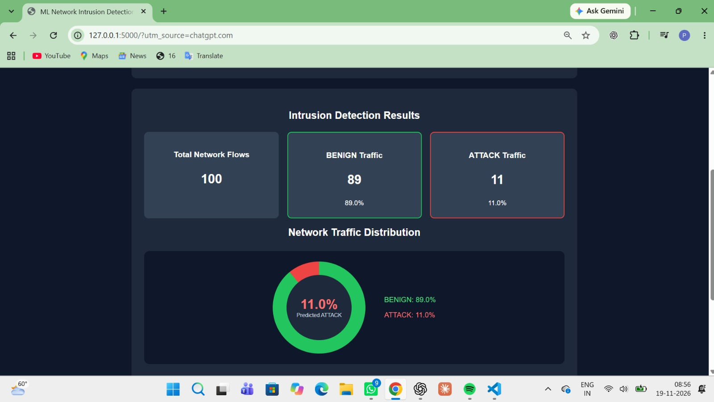
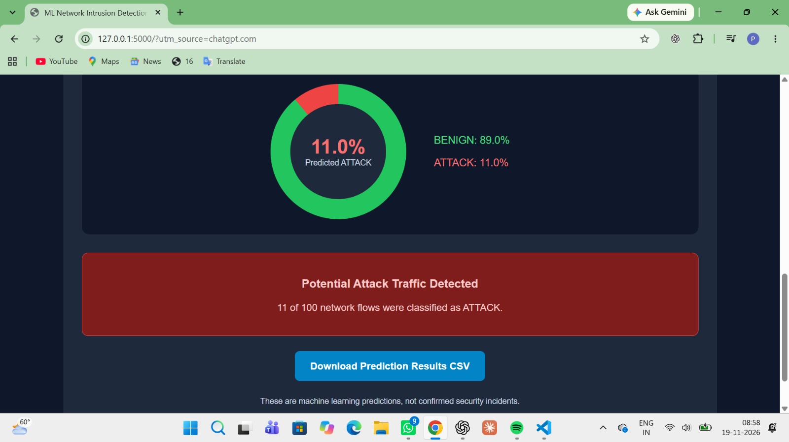
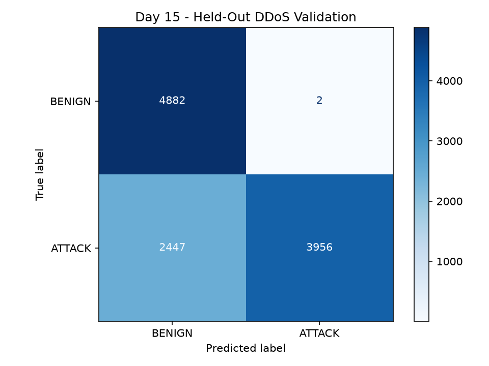
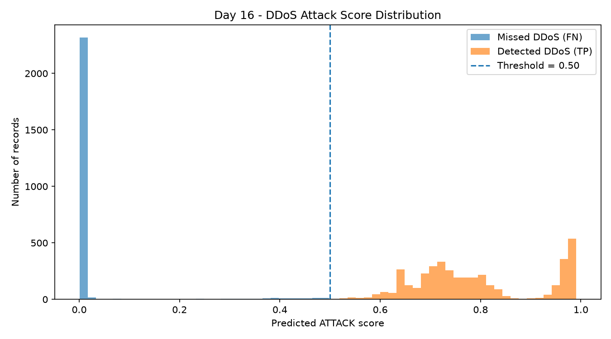
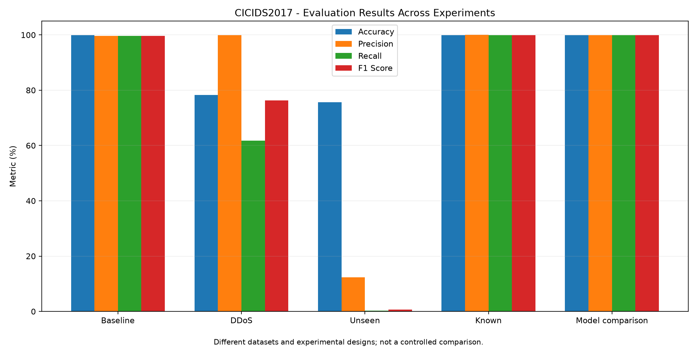

# ML-Based Network Intrusion Detection System

A machine learning-based Network Intrusion Detection System (NIDS)
developed using Python, Scikit-learn, XGBoost, and Flask.

The project analyzes network traffic flow features and classifies
traffic as **BENIGN** or **ATTACK**.

It includes data preprocessing, machine learning model comparison,
performance evaluation, automated testing, and an interactive
Flask web dashboard.

**Project Status:** Functional local prototype with automated
application testing completed.

**Author:** Priyanka Sridhar

**GitHub Repository:**
https://github.com/PriyankaSridhar17/ML-Based-Network-Intrusion-Detection-System

---

## 1. Project Overview

Network Intrusion Detection Systems help identify potentially
malicious activity by analyzing network traffic.

This project uses supervised machine learning to classify
network traffic records into two categories:

- **BENIGN (0):** Traffic predicted to be legitimate.
- **ATTACK (1):** Traffic predicted to be potentially malicious.

The system analyzes pre-extracted network flow features
from CSV files rather than capturing live network packets.

Three machine learning classifiers were implemented and
compared:

1. Decision Tree
2. Random Forest
3. XGBoost

XGBoost was selected as the project's best-performing
baseline based on the saved evaluation results.

A Flask web dashboard provides a user-friendly interface
for uploading CSV files, reviewing predictions, and
downloading results.

---

## 2. Project Objectives

- Analyze network traffic using machine learning.
- Prepare and clean the CICIDS2017 dataset.
- Perform exploratory data analysis.
- Train multiple classification algorithms.
- Compare model performance.
- Evaluate accuracy, precision, recall, and F1-score.
- Analyze confusion matrices and feature importance.
- Develop an interactive Flask dashboard.
- Validate uploaded network traffic datasets.
- Generate BENIGN and ATTACK predictions.
- Export prediction results to CSV.
- Implement automated application testing.
- Publish documented project code on GitHub.

---

## 3. Technologies Used

### Programming and Data Processing

- Python
- Pandas
- NumPy

### Machine Learning

- Scikit-learn
- XGBoost
- Joblib

### Data Visualization

- Matplotlib

### Web Application

- Flask
- HTML
- CSS

### Testing and Development

- Pytest 9.2.0
- Flask Test Client
- Visual Studio Code
- Git
- GitHub

---

## 4. Dataset

**Dataset:** CICIDS2017

CICIDS2017 contains network traffic records representing
benign network activity and several attack categories.

The dataset provides network flow characteristics that
can be used for intrusion detection research.

### Dataset Sampling

A 5% sample was collected from each source CSV file
in processing chunks to reduce computational requirements.

### Data Preprocessing

The preprocessing workflow included:

1. Loading source CSV files.
2. Sampling network traffic records.
3. Standardizing feature names.
4. Converting features to numeric values.
5. Replacing infinite values with missing values.
6. Removing records containing missing values.
7. Converting traffic labels into binary classes.
8. Removing duplicate feature records.
9. Splitting the cleaned dataset for model evaluation.

### Dataset Split

| Property | Value |
|---|---|
| Training records | 108,547 |
| Testing records | 27,137 |
| Total records | 135,684 |
| Training ratio | 80% |
| Testing ratio | 20% |
| Random state | 42 |
| Split method | Stratified random row split |

The split preserves the approximate class distribution
between the training and testing datasets.

However, random row splitting does not guarantee
independence between network capture sessions.

---

## 5. Machine Learning Models

### Decision Tree

A supervised learning algorithm that creates decision
rules based on network traffic features.

### Random Forest

An ensemble learning algorithm that combines multiple
decision trees to generate classifications.

### XGBoost

A gradient-boosted tree algorithm used to classify
network traffic based on learned feature patterns.

XGBoost was selected as the best-performing baseline
in the project's saved model comparison.

---

## 6. XGBoost Evaluation Results

The trained XGBoost classifier was evaluated using
27,137 saved test records.

| Evaluation Metric | Result |
|---|---|
| Accuracy | 99.87% |
| Precision | 99.62% |
| Recall | 99.68% |
| F1-score | 99.65% |
| True Negatives | 22,182 |
| False Positives | 19 |
| False Negatives | 16 |
| True Positives | 4,920 |

### Confusion Matrix Interpretation

- **True Negative:** BENIGN traffic correctly classified as BENIGN.
- **False Positive:** BENIGN traffic incorrectly classified as ATTACK.
- **False Negative:** ATTACK traffic incorrectly classified as BENIGN.
- **True Positive:** ATTACK traffic correctly classified as ATTACK.

False negatives are particularly important because
they represent attack traffic that was not detected.

### Evaluation Disclaimer

The reported metrics describe performance on the
project's saved test dataset.

They do not establish performance on live traffic,
unseen capture sessions, or independent network environments.

---

## 7. Feature Importance Analysis

XGBoost feature importance analysis was performed
to identify influential network traffic characteristics.

Important features included:

- Bwd Packet Length Std
- Average Packet Size
- Avg Bwd Segment Size
- Max Packet Length
- Bwd Header Length

Feature importance helps explain model behavior but
does not establish that a feature causes an attack.

---

## 8. Flask Network Security Dashboard

An interactive Flask application was developed
to demonstrate network intrusion detection predictions.

### Dashboard Features

- Upload network traffic CSV files.
- Validate uploaded datasets.
- Analyze traffic using the trained XGBoost classifier.
- Display total network flows.
- Display BENIGN prediction counts.
- Display ATTACK prediction counts.
- Calculate traffic classification percentages.
- Visualize network traffic distribution.
- Display potential attack alerts.
- Download prediction results as CSV.

### Dashboard Input Limits

| Configuration | Limit |
|---|---|
| Maximum upload size | 10 MB |
| Maximum rows per upload | 50,000 |
| Required network features | 78 |
| Supported upload format | CSV |

### Dashboard Screenshots

#### Dashboard Homepage

#### Intrusion Detection Results

#### Potential Attack Alert

### Example Prediction Results

A demonstration CSV containing 100 network traffic
records produced the following predictions:

| Prediction Category | Count | Percentage |
|---|---:|---:|
| BENIGN | 89 | 89.0% |
| ATTACK | 11 | 11.0% |
| Total | 100 | 100.0% |

These values are predictions for the demonstration
input and are not confirmed security incidents.

---

## 9. Input Validation

The Flask application includes checks for:

- Missing uploaded files.
- Unsupported file extensions.
- Empty CSV datasets.
- Missing required network features.
- Duplicate column names.
- Nonnumeric feature values.
- Missing numerical values.
- Infinite numerical values.
- Oversized file uploads.
- Excessive row counts.

Input validation reduces errors and helps prevent
unsupported datasets from reaching the prediction stage.

---

## 10. Automated Flask Application Testing

Automated application tests were implemented using
**Pytest 9.2.0** and the **Flask test client**.

The tests verify selected application behaviors
without requiring a web browser.

### Automated Test Coverage

| Test Case | Result |
|---|---|
| Homepage loading | PASSED |
| Missing uploaded file | PASSED |
| Unsupported file extension | PASSED |
| Empty CSV upload | PASSED |
| Missing required features | PASSED |
| Nonnumeric feature values | PASSED |
| Download without predictions | PASSED |
| Oversized file upload | PASSED |
| Successful prediction and CSV download | PASSED |

### Day 14 Test Results

| Metric | Result |
|---|---|
| Total tests | 9 |
| Passed | 9 |
| Failed | 0 |
| Errors | 0 |
| Execution time | 4.82 seconds |
| Testing framework | Pytest 9.2.0 |

All nine tests passed during the verified Day 14 test run.

### Prediction and Download Test

The successful prediction test uses a controlled
mock classifier to verify:

1. Valid CSV upload.
2. Processing of two network traffic records.
3. Generation of BENIGN and ATTACK predictions.
4. Successful prediction CSV download.
5. Verification of exported prediction labels.
6. Verification of exported prediction classes.

The mock classifier returns known predictions to
verify the application's processing workflow.

This test does not measure the accuracy of the
trained XGBoost model.

### Running Automated Tests

From the project root directory, run:

    python -m pytest tests/test_app.py -v --basetemp=".pytest_temp"

Expected verified test count:

    9 passed

### Testing Limitations

The automated tests cover selected Flask application
behaviors.

They do not constitute a complete security audit,
load test, or independent model evaluation.

Additional testing is recommended before deploying
the application in a production environment.

---

## 11. Data Leakage Investigation

Data leakage checks were performed to investigate
possible overlap between training and testing records.

### Investigation Results

| Check | Result |
|---|---:|
| Duplicate training feature rows | 0 |
| Duplicate testing feature rows | 0 |
| Exact train/test feature overlap | 0 |
| Rounded feature overlap | 129 |

The 129 rounded feature matches do not automatically
indicate data leakage.

However, related network sessions or capture periods
may appear in both training and testing datasets.

Further session-independent evaluation is required
to assess model generalization.

---

## 12. Project Structure

    ML_Network_IDS/
    |
    |-- app.py
    |-- analyze_data.py
    |-- check_data_leakage.py
    |-- check_data_quality.py
    |-- compare_models.py
    |-- count_attacks.py
    |-- explore_data.py
    |-- main.py
    |-- preprocess_data.py
    |-- split_data.py
    |-- train_decision_tree.py
    |-- train_random_forest.py
    |-- train_xgboost.py
    |-- validate_model.py
    |
    |-- data/
    |-- models/
    |-- reports/
    |-- exports/
    |
    |-- screenshots/
    |   |-- dashboard_home.png
    |   |-- prediction_results.png
    |   |-- attack_alert.png
    |
    |-- templates/
    |   |-- index.html
    |
    |-- static/
    |   |-- style.css
    |
    |-- tests/
    |   |-- test_app.py
    |
    |-- .gitignore
    |-- README.md
    |-- requirements.txt

### Important Repository Notes

The following files are excluded from GitHub:

- Raw and processed datasets.
- Trained model files.
- Generated prediction exports.
- Virtual environments.
- Temporary testing files.
- Local backup files.
- Sensitive environment configuration.

The model artifact must be generated locally
or provided separately before running the dashboard.

---

## 13. Installation and Setup

### Step 1: Clone the Repository

    git clone https://github.com/PriyankaSridhar17/ML-Based-Network-Intrusion-Detection-System.git

### Step 2: Open the Project Directory

    cd ML-Based-Network-Intrusion-Detection-System

### Step 3: Create a Virtual Environment

    python -m venv .venv

### Step 4: Activate the Virtual Environment

Windows PowerShell:

    .\.venv\Scripts\Activate.ps1

### Step 5: Install Dependencies

    python -m pip install -r requirements.txt

### Step 6: Configure the Flask Secret Key

Set a secure secret key in your PowerShell session:

    $env:FLASK_SECRET_KEY = python -c "import secrets; print(secrets.token_hex(32))"

The key should be provided through the environment
rather than hardcoded into the application.

### Step 7: Provide the Trained Model

The Flask application requires a compatible trained
XGBoost model at:

    models/xgboost_model.joblib

The saved model must be compatible with the
application's required network features.

If the model is not available, it must be generated
using the project's training pipeline.

### Step 8: Start the Flask Application

    python app.py

### Step 9: Open the Dashboard

Open the following address in your browser:

http://127.0.0.1:5000

### Step 10: Upload Network Traffic Data

Upload a compatible CSV containing the required
78 network traffic features.

The dashboard will display classification results
and allow prediction results to be downloaded.

---

## 14. Model Validation

Model evaluation was performed using the saved
test dataset.

Validation activities included:

- Accuracy evaluation.
- Precision evaluation.
- Recall evaluation.
- F1-score evaluation.
- Confusion matrix analysis.
- Feature importance analysis.
- Duplicate record checks.
- Train/test overlap investigation.
- Input feature consistency checks.

These evaluations provide an initial assessment
of model behavior on the sampled CICIDS2017 dataset.

---

## 15. Security Considerations

The application is intended for local development
and academic demonstration.

Current security-related practices include:

- Environment-based Flask secret key configuration.
- Flask debug mode disabled.
- Localhost-only application binding.
- CSV upload validation.
- File upload size limits.
- Required feature validation.
- Temporary testing file exclusions.
- Sensitive file exclusions through .gitignore.

Additional hardening is required before deployment
on a publicly accessible server.

---

## 16. Project Limitations

- The model was evaluated on sampled CICIDS2017 data.
- Random row splitting does not ensure session independence.
- The model has not been independently validated on live traffic.
- The dashboard processes uploaded CSV files rather than live packets.
- Predictions are not confirmed security incidents.
- The trained model is not included in the public repository.
- Automated tests cover selected application behaviors only.
- Public deployment requires additional security hardening.
- Per-user prediction result isolation requires improvement.

---

## 17. Future Improvements

Planned improvements include:

1. Independent capture-session model evaluation.
2. Stronger model generalization testing.
3. Expanded automated test coverage.
4. Improved Flask deployment security.
5. Per-user prediction result isolation.
6. Additional network security visualizations.
7. Improved attack investigation and reporting.
8. Exploration of real-time traffic ingestion.
9. Improved reproducibility and deployment documentation.

---

## 18. Project Progress

### Completed

- Dataset sampling and preprocessing.
- Exploratory data analysis.
- Decision Tree model development.
- Random Forest model development.
- XGBoost model development.
- Model comparison and evaluation.
- Confusion matrix analysis.
- Feature importance analysis.
- Data leakage investigation.
- Flask dashboard development.
- CSV upload validation.
- Prediction result visualization.
- Prediction CSV export.
- GitHub repository publication.
- Dashboard screenshot documentation.
- Nine passing automated Flask application tests.

### Ongoing

- Independent model evaluation.
- Application security improvements.
- Additional automated testing.
- Deployment and reproducibility improvements.

---

## 19. Author

**Priyanka Sridhar**

Master's in Computer Engineering  
California State University, Fullerton

**Areas of Interest:**

- Network Engineering
- Network Security
- Machine Learning
- Network Intrusion Detection
- IT Infrastructure

**GitHub:**
https://github.com/PriyankaSridhar17

---

## 20. Disclaimer

This project is intended for academic research,
learning, and demonstration purposes.

The reported evaluation metrics describe performance
on the project's saved test dataset.

They do not establish performance in live,
independent, or production network environments.

Machine learning predictions should not be treated
as confirmed security incidents without additional
investigation.

---

## Day 15 — Independent Source-File Validation

### Objective

Evaluate whether an XGBoost intrusion detection classifier
can identify malicious traffic from a held-out CICIDS2017
capture containing an attack category absent from training.

### Experimental Design

- Dataset: CICIDS2017
- Training: Seven original source CSV files
- Testing: Friday Afternoon DDoS capture
- Model: Separately trained XGBoost classifier
- Sampling: 5% of each source file
- Features: 78 network traffic characteristics
- Training records: 124,492
- Testing records: 11,287
- Overlapping source files: 0

The original trained model and Flask dashboard were
preserved without modification.

### Experimental Results

| Metric | Result |
|---|---:|
| Accuracy | 78.30% |
| Precision | 99.95% |
| Recall | 61.78% |
| F1-score | 76.36% |
| True Negatives | 4,882 |
| False Positives | 2 |
| False Negatives | 2,447 |
| True Positives | 3,956 |

### Confusion Matrix

### Interpretation

The experimental classifier achieved high precision,
but detected only 61.78% of the DDoS attack records.

Of 6,403 actual DDoS records, 2,447 were incorrectly
classified as BENIGN.

This indicates limited recall for the previously unseen
DDoS attack category in the held-out capture.

### Comparison with Original Baseline

| Metric | Random-Split Baseline | Day 15 Holdout |
|---|---:|---:|
| Accuracy | 99.87% | 78.30% |
| Precision | 99.62% | 99.95% |
| Recall | 99.68% | 61.78% |
| F1-score | 99.65% | 76.36% |

These evaluations are not directly controlled comparisons.
They use different training and testing distributions and
potentially different XGBoost hyperparameters.

The difference does not establish data leakage in the
original experiment.

### Limitations

- The experiment used sampled CICIDS2017 traffic.
- Source-file separation does not guarantee complete
  independence between network sessions.
- DDoS was absent from the training attack categories.
- The results do not establish live-network performance.
- Additional capture-based validation is necessary.

### Research Artifacts

- [Validation script](experiments/day15/independent_validation.py)
- [Evaluation metrics](experiments/day15/validation_metrics.csv)
- [Classification report](experiments/day15/classification_report.txt)
- [Experiment summary](experiments/day15/experiment_summary.json)

### Future Work

- Evaluate additional held-out attack categories.
- Investigate false-negative patterns.
- Perform threshold tuning using separate validation data.
- Compare models under controlled experimental conditions.
- Explore independent capture-session evaluation.

---

## Day 16 — False-Negative Investigation

### Objective

Investigate why the experimental XGBoost classifier
failed to identify 2,447 DDoS attack records during
the Day 15 source-file holdout evaluation.

### Methodology

- Reconstructed the original Day 15 held-out test sample.
- Loaded the previously trained experimental XGBoost model.
- Reproduced the original confusion matrix.
- Analyzed predicted ATTACK scores.
- Compared traffic features between missed and detected attacks.
- Preserved the original classification threshold of 0.50.

No model retraining or threshold optimization was performed.

### Reproduced Evaluation Results

| Metric | Result |
|---|---:|
| Test records | 11,287 |
| True negatives | 4,882 |
| False positives | 2 |
| False negatives | 2,447 |
| True positives | 3,956 |
| Attack recall | 61.78% |

### Prediction Score Analysis

| Outcome | Records | Mean score | Median score |
|---|---:|---:|---:|
| False Negative | 2,447 | 0.01990 | 0.00175 |
| False Positive | 2 | 0.67412 | 0.67412 |
| True Negative | 4,882 | 0.00233 | 0.000099 |
| True Positive | 3,956 | 0.78993 | 0.75937 |

Missed DDoS attacks received substantially lower
ATTACK scores than correctly detected attacks.

This suggests that many missed attacks were classified
as strongly BENIGN-like by the experimental model,
rather than narrowly falling below the 0.50 threshold.

### Feature Comparison

| Feature | False Negative Median | True Positive Median |
|---|---:|---:|
| Flow Bytes/s | 4.56 | 10,806.70 |
| Flow Packets/s | 0.76 | 7.55 |
| Total Backward Packets | 0 | 5 |
| Average Packet Size | 7.5 | 1,292.56 |
| Bwd Packet Length Std | 0 | 3,173.37 |

The missed attacks exhibited lower median flow rates,
packet sizes, and backward packet activity.

These observations suggest possible differences in
traffic patterns, but do not establish causation.

### Attack Score Visualization

### Research Findings

1. The Day 15 confusion matrix was successfully reproduced.
2. The experimental classifier missed 2,447 DDoS records.
3. Missed attacks had very low median ATTACK scores.
4. Descriptive feature differences were observed between
   missed and correctly detected attacks.
5. Threshold adjustment alone may not address all
   generalization limitations.

### Limitations

- Analysis was performed on sampled CICIDS2017 traffic.
- The held-out capture contains an attack category absent
  from the experimental training data.
- Prediction scores are not necessarily calibrated probabilities.
- Feature comparisons are descriptive, not causal.
- The held-out test data was not used to select a new threshold.
- Results do not establish performance on live network traffic.

### Day 16 Research Artifacts

- [False-negative analysis script](experiments/day16/false_negative_analysis.py)
- [Analysis summary](experiments/day16/analysis_summary.json)
- [Attack score statistics](experiments/day16/score_summary.csv)
- [Feature comparison](experiments/day16/feature_comparison.csv)
- [Attack score visualization](experiments/day16/attack_score_distribution.png)

### Next Steps

- Investigate training-data distribution differences.
- Design a separate validation set for threshold selection.
- Evaluate class imbalance mitigation strategies.
- Compare experimental models under controlled conditions.
- Test generalization across additional held-out captures.

---

## Day 17 — Source-Separated Unseen-Attack Validation

### Objective

Investigate whether class weighting and classification
threshold adjustments improve XGBoost attack detection
on CICIDS2017 source captures excluded from training.

### Experimental Design

- Training sources: 5 CICIDS2017 CSV files
- Validation sources: 2 separate CSV files
- Training records: 89,052
- Validation records: 36,198
- Input features: 78
- Model: XGBoost binary classifier
- Classification thresholds: 0.30, 0.50, 0.70
- Class weights: 1.0 and 7.7641

The Friday afternoon DDoS capture was excluded from
training and validation.

### Validation Attack Categories

The validation sources contain:

- PortScan
- FTP-Patator
- SSH-Patator

These attack categories were absent from the training
source files.

This experiment therefore investigates generalization
to previously unseen attack categories.

### Selected Validation Configuration

| Metric | Result |
|---|---:|
| Configuration | Balanced XGBoost |
| Class weight | 7.7641 |
| Classification threshold | 0.30 |
| Accuracy | 75.68% |
| Precision | 12.39% |
| Recall | 0.324% |
| F1-score | 0.632% |
| False positives | 198 |
| False negatives | 8,604 |
| True positives | 28 |

The selected configuration achieved the highest F1-score
among the six evaluated configurations.

However, all configurations exhibited extremely low
attack recall.

### Research Findings

1. Source-separated validation exposed substantial
   generalization limitations.

2. The selected model detected only 28 of 8,632
   actual attack records.

3. Increasing the positive-class weight produced
   a small recall increase but also increased
   false positives.

4. Lowering the classification threshold did not
   meaningfully resolve the detection problem.

5. The results do not establish improved performance
   on unseen DDoS traffic.

### Limitations

- Validation used two source captures.
- Validation attack categories were absent from training.
- Class weighting and thresholds were evaluated using
  the same validation dataset.
- Selecting the best configuration on this dataset
  introduces model-selection bias.
- Exact feature-duplicate filtering does not guarantee
  complete network-session independence.
- No independent final evaluation of the selected
  configuration was performed.

### Research Artifacts

- [Validation experiment](experiments/day17/validation_optimization.py)
- [Validation comparison](experiments/day17/validation_comparison.csv)
- [Experiment summary](experiments/day17/validation_summary.json)

### Future Research

- Design a separate known-attack validation experiment.
- Investigate capture-session-level data separation.
- Evaluate additional attack categories.
- Compare class-weighting strategies.
- Assess generalization on new independent captures.

---

## Day 18 — Known-Attack Validation

### Objective

Evaluate XGBoost performance on familiar attack categories
using a stratified training-validation split within the
Wednesday CICIDS2017 capture.

### Experimental Setup

- Dataset: Wednesday CICIDS2017 capture
- Features: 78 network traffic characteristics
- Training records: 25,238
- Validation records: 6,310
- Training/validation split: 80/20
- Models: Standard and class-weighted XGBoost
- Thresholds evaluated: 0.30, 0.50, 0.70
- Rare-category exclusion: 1 Heartbleed record

Exact duplicate feature records were removed before splitting.

### Best Validation Results

| Metric | Result |
|---|---:|
| Accuracy | 99.9525% |
| Precision | 100.0000% |
| Recall | 99.8498% |
| F1-score | 99.9248% |
| True negatives | 4,313 |
| False positives | 0 |
| False negatives | 3 |
| True positives | 1,994 |

Two configurations achieved the same reported best F1-score:

- Standard XGBoost at threshold 0.50
- Balanced XGBoost at threshold 0.70

### Research Interpretation

The experimental classifiers performed strongly on known
attack categories from the same source capture.

However, these results do not establish independent
network-session generalization.

The earlier Day 15 and Day 17 experiments showed much
lower recall on attack categories excluded from training.

These experiments use different datasets and evaluation
designs and should not be interpreted as direct evidence
of model improvement.

### Limitations

- Training and validation used the same source capture.
- Related network flows may appear in both subsets.
- Exact duplicate removal does not eliminate all leakage risks.
- The single sampled Heartbleed record was excluded.
- The best configuration was selected using validation results.
- No independent final test was performed for this configuration.

### Research Artifacts

- [Known-attack validation script](experiments/day18/known_attack_validation.py)
- [Model comparison](experiments/day18/known_attack_comparison.csv)
- [Experiment summary](experiments/day18/known_attack_summary.json)

---

## Day 19 — Controlled XGBoost Model Comparison

### Objective

Investigate whether changing XGBoost model complexity
improves known-attack classification performance under
consistent experimental conditions.

### Dataset and Methodology

Dataset: CICIDS2017 Wednesday capture.

- Network features: 78
- Cleaned records: 31,548
- Training records: 18,928
- Validation records: 6,310
- Supplementary evaluation records: 6,310
- Split: Stratified 60/20/20
- Classification threshold: 0.50
- Class weight: 1.0
- Random state: 42

Exact duplicate feature records were removed before
splitting the dataset.

The single sampled Heartbleed record was excluded
because it could not support stratified evaluation.

### Model Configurations

| Model | Max Depth | Estimators |
|---|---:|---:|
| Baseline | 5 | 150 |
| Shallow | 3 | 150 |
| Deep | 7 | 150 |
| More Trees | 5 | 250 |

All configurations used the same training and validation
subsets and consistent evaluation parameters.

### Validation Results

| Model | F1-score | Recall | False Positives |
|---|---:|---:|---:|
| Baseline | 99.8249% | 99.9499% | 6 |
| Shallow | 99.7998% | 99.8998% | 6 |
| Deep | 99.8498% | 99.9499% | 5 |
| More Trees | 99.8499% | 100.0000% | 6 |

The More Trees configuration achieved the highest
validation F1-score.

However, the difference between the Deep and More Trees
configurations was negligible.

### Selected Configuration

- Algorithm: XGBoost
- Maximum depth: 5
- Number of estimators: 250
- Learning rate: 0.1
- Classification threshold: 0.50
- Class weight: 1.0

The selected configuration was evaluated separately
on the supplementary evaluation subset.

### Supplementary Evaluation Results

| Metric | Result |
|---|---:|
| Accuracy | 99.9208% |
| Precision | 99.8998% |
| Recall | 99.8498% |
| F1-score | 99.8748% |
| True Negatives | 4,311 |
| False Positives | 2 |
| False Negatives | 3 |
| True Positives | 1,994 |

### Research Findings

1. All four configurations achieved high performance
   on the within-capture validation subset.

2. Increasing the number of trees produced only a
   negligible improvement in validation F1-score.

3. The selected model achieved similarly high
   performance on the supplementary evaluation subset.

4. These findings do not demonstrate improved
   independent-capture generalization.

5. More complex models are not necessarily better
   for intrusion detection.

### Experimental Limitations

- All subsets originated from the same Wednesday capture.
- Related network flows may cross split boundaries.
- The Wednesday capture was used in earlier experiments.
- Supplementary evaluation is not a fully untouched test.
- Model selection was based on validation F1-score.
- The Friday DDoS holdout was excluded.
- Results do not establish performance on unseen attacks
  or independent network captures.

### Day 19 Research Artifacts

- [Model comparison script](experiments/day19/model_comparison.py)
- [Validation comparison](experiments/day19/model_comparison.csv)
- [Selected model evaluation](experiments/day19/selected_model_evaluation.csv)
- [Experiment summary](experiments/day19/model_comparison_summary.json)

### Conclusion

Controlled hyperparameter comparisons showed that
increasing XGBoost complexity provided little additional
benefit on the known-attack validation dataset.

Further research should prioritize independent-capture
evaluation, generalization, and reliable attack detection
rather than maximizing within-capture accuracy.

---

## Day 20 — Consolidated Model Evaluation

### Objective

Consolidate the evaluation results from the original
XGBoost baseline and the Day 15–19 experiments.

The consolidation uses saved research reports and
does not retrain or modify existing classifiers.

### Evaluation Summary

| Experiment | Accuracy | Precision | Recall | F1-score |
|---|---:|---:|---:|---:|
| Day 11 — Original Baseline | 99.87% | 99.62% | 99.68% | 99.65% |
| Day 15 — Held-out DDoS | 78.30% | 99.95% | 61.78% | 76.36% |
| Day 17 — Unseen Attack Validation | 75.68% | 12.39% | 0.32% | 0.63% |
| Day 18 — Known Attack Validation | 99.95% | 100.00% | 99.85% | 99.92% |
| Day 19 — Model Comparison | 99.92% | 99.90% | 99.85% | 99.87% |

### Evaluation Visualization

### Key Research Findings

1. The original random-split XGBoost baseline achieved
   99.87% accuracy on its saved test dataset.

2. The held-out DDoS experiment achieved 61.78% recall,
   with 2,447 false-negative attack records.

3. The Day 17 source-separated validation achieved
   approximately 0.32% recall on attack categories
   excluded from training.

4. Within-capture known-attack validation achieved
   approximately 99.85% recall.

5. Increasing XGBoost model complexity provided only
   negligible improvement in within-capture validation.

### Interpretation

High within-capture classification performance does
not guarantee strong generalization to attack categories
absent from training.

The experiments used different training datasets,
attack distributions, and model configurations.

Therefore, their results should not be interpreted
as a controlled comparison of one classifier.

### Limitations

- Some experiments used random within-capture splits.
- Related network flows may appear across subsets.
- Source-file separation does not guarantee complete
  network-session independence.
- Some model configurations were selected using
  validation data.
- The experiments used sampled CICIDS2017 traffic.
- Independent live-network performance is unverified.

### Research Artifacts

- [Consolidated evaluation script](experiments/day20/final_evaluation.py)
- [Consolidated metrics](experiments/day20/consolidated_metrics.csv)
- [Evaluation report](experiments/day20/final_evaluation_report.txt)
- [Research summary](experiments/day20/final_research_summary.json)

### Conclusion

The project demonstrates successful implementation
of a machine learning-based network intrusion
detection prototype.

However, independent validation experiments reveal
important limitations in detecting previously unseen
attack patterns.

Further work should prioritize model generalization,
independent capture evaluation, and operational
reliability rather than relying exclusively on
high random-split accuracy.
